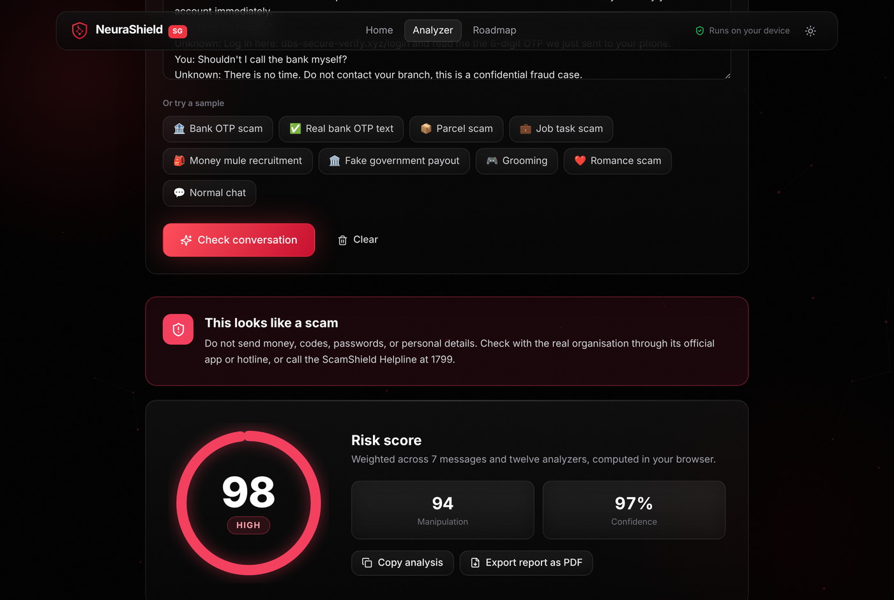
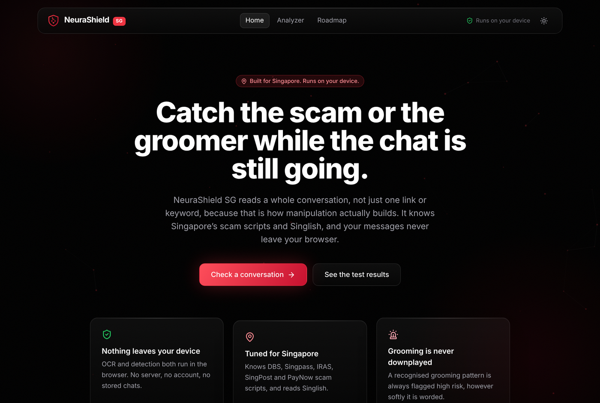
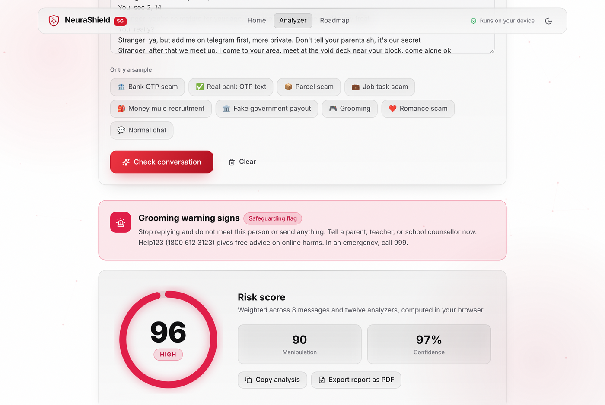

# NeuraShield SG

NeuraShield SG checks a chat conversation for Singapore scam scripts and online grooming, and explains what it finds. It runs entirely in the browser, so nothing you paste or upload leaves your device.



<details>
<summary>More screenshots</summary>




</details>

## Background

This is the Singapore version of NeuraShield Lite, made for Samsung Solve for Tomorrow 2026 under the Trust, Security and Privacy theme.

Lite is a general tool. Most scams young people in Singapore actually see are local: messages pretending to be DBS, Singpass, IRAS or SingPost, PayNow requests, job and task scams, money mule offers. A general filter misses a lot of these, so I took Lite's engine and localised it, added a grooming detector aimed at school-age users, and tested it on Singapore-style chats, including Singlish.

## What it does

- Reads a pasted conversation, a WhatsApp chat export, or a chat screenshot (OCR with Tesseract.js)
- Gives a verdict: safe, scam, or grooming
- Scores the risk from 0 to 100 and shows how it changes over the conversation
- Highlights the phrases that triggered it, with an explanation and what to do next, including local hotlines
- Lists things it recognised as harmless, like a real bank OTP text or a "we will never ask for your password" notice
- Light and dark mode

## What it knows about Singapore

- Impersonation of local banks, telcos, Singpass and agencies (DBS, POSB, OCBC, UOB, Singtel, StarHub, IRAS, CPF, MOM, ICA)
- SingPost and Ninja Van parcel scripts
- PayNow and PayLah! pressure
- Job and task scams, money mule recruitment, "new number" impersonation, Carousell fake buyers, "safety account" police scams
- Grooming meet-ups at void decks and MRT stations
- Singlish. It only counts as a supporting signal next to a real warning sign, so normal Singlish chat is never flagged on its own.

## How the detection works

It is a rule engine, so every decision can be traced back to a rule.

1. **Parsing.** The text is split into messages by speaker. WhatsApp timestamps are stripped. Your own messages (`You:` or `Me:`) are never scored.
2. **Twelve analyzers.** Scam scripts, Singapore impersonation, grooming, urgency, authority, money requests, threats, credentials, emotional pressure, secrecy, links, and Singlish. Each is a list of patterns with a weight and an explanation.
3. **Context.** Safety advice, a code being sent to you, and someone talking about another person's code are set aside before scoring.
4. **Scoring.** Signals that appear together score more than either alone. Bank names and PayNow only count if something else suspicious is in the chat. Repeating one weak signal has diminishing returns.
5. **Safety floors.** A recognised grooming pattern is always HIGH with a safeguarding flag. An OTP or password request, remote access or a look-alike link is always at least MEDIUM.

## Testing

**Main set:** 100 labelled conversations (50 normal, 25 scam, 25 grooming, 44 of them in Singlish).

| | Result |
|---|---|
| Overall accuracy | 87 / 100 |
| Grooming caught | 25 / 25, all with the safeguarding flag |
| False alarms on normal chats | 0 / 50 |
| Keyword blocklist on the same set | 68% |

**Stress test:** 97 harder cases written to break it, like real OTP texts, people describing scams, teachers and parents using grooming-like words, typos and WhatsApp exports. Set A was used to find and fix weaknesses. Set B was written at the same time and kept out of tuning.

| | Before fixes | After |
|---|---|---|
| Set A (used for tuning) | 60.0% | 100% |
| Set B (held out) | 73.7% | 86.8% |
| False alarms on hard normal chats | 9 / 40 | 0 / 40 |

Full results: [evaluation/RESULTS.md](evaluation/RESULTS.md) and [evaluation/STRESS.md](evaluation/STRESS.md).

## Running it

You need Node.js 18 or newer.

```bash
npm install
npm run dev            # local dev server
npm run build          # build into dist/
npm run preview        # serve the build
npm run build:single   # one self-contained HTML file in dist-single/
npm run eval           # run the main test set
npm run stress         # run the stress test
```

`npm install` also copies the OCR files into `public/tesseract/`, so screenshot reading works offline when the app is served. The single HTML file downloads them from a CDN the first time you upload a screenshot. Pasting text works offline either way.

## Limitations

- It matches wording, not meaning. Scam recall on the main set is 48%, and five held-out scams are still missed. They are left unfixed so the held-out score stays honest.
- English and Singlish only.
- A parent saying "don't tell your dad, are you home alone" is flagged as grooming. From text alone a parent and a groomer can write the same words, so it errs toward caution.

## Built with

React, Vite, Tailwind CSS, Framer Motion, Lucide icons and Tesseract.js.

## License

MIT
